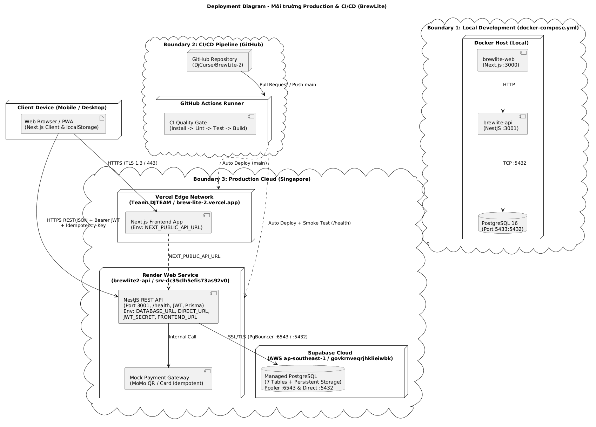

# Kiến trúc Triển khai Hệ thống (Deployment & Operations)

## 1. Sơ đồ triển khai tổng thể


## 2. Triển khai môi trường Local (Docker Compose)
Từ thư mục gốc của dự án (`BrewLite-2/`), sao chép tệp cấu hình mẫu và khởi chạy đồng bộ toàn bộ 3 dịch vụ (Frontend, Backend, PostgreSQL 16):

```bash
cp .env.example .env
docker compose up -d --build
```

Sau khi các container khởi động thành công, hệ thống hoạt động tại các địa chỉ:
- **Frontend (Next.js PWA):** `http://localhost:3000`
- **Backend (NestJS REST API):** `http://localhost:3001`
- **Health Check Endpoint:** `http://localhost:3001/health`
- **PostgreSQL 16:** ánh xạ cổng `5433:5432` trên máy chủ cục bộ

Để nạp dữ liệu mẫu (12 món đồ uống, 3 tài khoản theo vai trò và 4 mã khuyến mãi) vào cơ sở dữ liệu:

```bash
docker compose exec api npx prisma db push
docker compose exec api npx prisma db seed
```

## 3. Triển khai môi trường Production Cloud (Singapore)
Hệ thống được phân tách 3 tầng kiến trúc lên 3 nền tảng đám mây đặt tại phân vùng Singapore (`ap-southeast-1`) và giao tiếp hoàn toàn qua giao thức HTTPS:

| Tầng hệ thống | Nền tảng | Định danh dịch vụ | Đường dẫn & Thông số cấu hình |
| :--- | :--- | :--- | :--- |
| **Database** | **Supabase** (PostgreSQL) | Project Ref: `govkrnveqrjhklieiwbk` | Cụm AWS `ap-southeast-1` (Singapore); Transaction Pooler cổng `6543` và Session Pooler cổng `5432`. |
| **Backend API** | **Render** (Web Service) | `brewlite2-api` (`srv-dc35clh5efis73as92v0`) | URL: `[https://brewlite2-api.onrender.com](https://brewlite2-api.onrender.com)` (Root Directory: `apps/api`). |
| **Frontend Web** | **Vercel** | Team `DJTEAM` (`djteam3`) / Project `brewlite-2` | URL: `[https://brew-lite-2.vercel.app](https://brew-lite-2.vercel.app)` (Root Directory: `apps/web`). |

### 3.1. Cấu hình dịch vụ Backend trên Render (`apps/api`)
- **Build Command:**
  ```bash
  npm install --include=dev && npx prisma generate && npm run build
  ```
- **Start Command:**
  ```bash
  npm run start:prod
  ```
- **Đồng bộ lược đồ & dữ liệu mẫu lên Supabase:**
  ```bash
  npx prisma db push
  npx prisma db seed
  ```

### 3.2. Cấu hình ứng dụng Frontend trên Vercel (`apps/web`)
- Import kho mã nguồn `DjCurse/BrewLite-2` vào không gian làm việc `DJTEAM`, chọn **Root Directory** là `apps/web` và **Framework Preset** là `Next.js`.
- Khai báo biến môi trường `NEXT_PUBLIC_API_URL` trỏ về `[https://brewlite2-api.onrender.com](https://brewlite2-api.onrender.com)` cho cả môi trường **Production** và **Preview**.

## 4. Cấu hình biến môi trường (Environment Variables)
Toàn bộ thông tin nhạy cảm được loại trừ khỏi Git qua `.gitignore` và cấu hình trực tiếp trên bảng điều khiển của từng nền tảng:

| Tên biến môi trường | Nơi cấu hình | Giá trị / Định dạng | Mục đích sử dụng |
| :--- | :--- | :--- | :--- |
| `NEXT_PUBLIC_API_URL` | Vercel (`brewlite-2`) | `[https://brewlite2-api.onrender.com](https://brewlite2-api.onrender.com)` | Địa chỉ REST API công khai để trình duyệt gọi dữ liệu từ Backend. |
| `DATABASE_URL` | Render (`brewlite2-api`) | `postgresql://postgres.govkrnveqrjhklieiwbk:<PASSWORD>@[aws-1-ap-southeast-1.pooler.supabase.com:6543/postgres?pgbouncer=true](https://aws-1-ap-southeast-1.pooler.supabase.com:6543/postgres?pgbouncer=true)` | Chuỗi kết nối qua Transaction Pooler cổng `6543` phục vụ truy vấn thực tế. |
| `DIRECT_URL` | Render (`brewlite2-api`) | `postgresql://postgres.govkrnveqrjhklieiwbk:<PASSWORD>@[aws-1-ap-southeast-1.pooler.supabase.com:5432/postgres](https://aws-1-ap-southeast-1.pooler.supabase.com:5432/postgres)` | Chuỗi kết nối qua Session Pooler cổng `5432` phục vụ đồng bộ lược đồ Prisma. |
| `JWT_SECRET` | Render (`brewlite2-api`) | Chuỗi khóa bí mật | Ký và xác thực chữ ký số cho `accessToken` (JWT). |
| `FRONTEND_URL` | Render (`brewlite2-api`) | `[https://brew-lite-2.vercel.app](https://brew-lite-2.vercel.app)` | Cấu hình bảo mật CORS và sinh liên kết thanh toán qua mã QR MoMo. |

## 5. Tự động hóa CI/CD, Smoke Test và Quy trình Rollback
- **CI Quality Gate (`.github/workflows/ci.yml`):** Tự động chạy `Install -> Lint -> Unit/Component Test -> Build` trên mỗi Pull Request và chặn merge nếu có lỗi.
- **Continuous Deployment (Auto-deploy):** Khi hợp nhất mã nguồn vào nhánh `main`, cả **Vercel** và **Render** tự động kéo bản cập nhật mới nhất, biên dịch và phát hành phiên bản mới.
- **Smoke Test sau triển khai:** Kiểm tra trạng thái sống của API và kết nối cơ sở dữ liệu thông qua endpoint `GET [https://brewlite2-api.onrender.com/health](https://brewlite2-api.onrender.com/health)` (trả về HTTP `200 OK`).
- **Quy trình Rollback khi gặp sự cố:**
  - **Trên Vercel:** Truy cập tab **Deployments** của dự án `brewlite-2`, chọn bản triển khai ổn định gần nhất và nhấn **Instant Rollback**.
  - **Trên Render:** Truy cập mục **Events / Deploys** của dịch vụ `brewlite2-api`, chọn bản build ổn định trước đó và nhấn **Rollback to this deploy**.