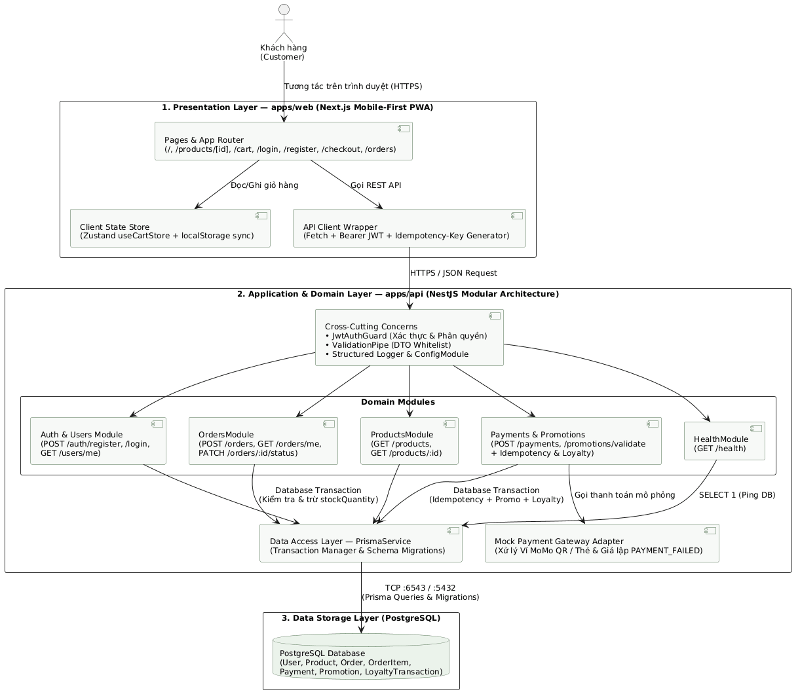

# Kiến trúc Tổng thể Hệ thống (System Architecture)

## 1. Tổng quan kiến trúc
Hệ thống **BrewLite** được thiết kế theo mô hình **Kiến trúc phân lớp (Layered Architecture)** kết hợp **Modular Monolith** trong cấu trúc kho mã nguồn hợp nhất (**Monorepo**). Cách tiếp cận này giúp phân tách rõ ràng trách nhiệm giữa tầng giao diện người dùng, tầng xử lý nghiệp vụ và tầng lưu trữ dữ liệu, đồng thời đơn giản hóa việc đóng gói Docker và kiểm thử tự động trong quy trình CI/CD.

---

## 2. Phân rã các tầng kiến trúc

### 2.1. Tầng trình diễn — `apps/web` (Next.js Mobile-first / PWA)
Tầng trình diễn được xây dựng bằng **Next.js (App Router)** và **TypeScript**, tối ưu trải nghiệm trên thiết bị di động theo chuẩn Progressive Web App (PWA):
* **Pages & App Router:** Cung cấp các tuyến giao diện chính gồm Trang thực đơn (`/`), Chi tiết sản phẩm (`/products/[id]`), Giỏ hàng (`/cart`), Đăng ký / Đăng nhập (`/register`, `/login`), Thanh toán (`/checkout`) và Theo dõi đơn hàng (`/orders`).
* **Client State Store (`Zustand`):** Quản lý trạng thái giỏ hàng (`useCartStore`) đồng bộ bền vững với `localStorage`, giúp giữ nguyên giỏ hàng khi tải lại trang.
* **API Client Wrapper:** Chuẩn hóa giao tiếp REST/JSON với Backend, tự động đính kèm header `Authorization: Bearer <JWT>` cho các API cần xác thực và sinh mã `Idempotency-Key` (UUID) cho các yêu cầu thanh toán.
* **Hỗ trợ PWA:** Tích hợp `manifest.ts`, Service Worker (`sw.js`) và trang dự phòng ngoại tuyến (`offline.html`) cùng xử lý đầy đủ 3 trạng thái giao diện (**Loading**, **Empty**, **Error**).

### 2.2. Tầng ứng dụng và nghiệp vụ — `apps/api` (NestJS Modular Monolith)
Backend được phát triển trên nền tảng **NestJS**, chia thành các module nghiệp vụ độc lập và các thành phần dùng chung:
* **Cross-Cutting Concerns:**
  * `JwtAuthGuard`: Kiểm tra chữ ký số và thời hạn của JWT token, bảo vệ các tài nguyên riêng tư và phân quyền theo vai trò (`CUSTOMER`, `STAFF`, `ADMIN`).
  * `ValidationPipe`: Kiểm tra và lọc dữ liệu đầu vào (DTO Whitelist) trước khi đưa vào tầng xử lý.
  * `ConfigModule` & CORS: Quản lý cấu hình biến môi trường tập trung và giới hạn nguồn gọi API từ tên miền Frontend hợp lệ (`FRONTEND_URL`).
* **Các Domain Module cốt lõi:**
  * `ProductsModule`: Cung cấp danh sách thực đơn có phân trang, lọc theo danh mục, tìm kiếm từ khóa và xem chi tiết món.
  * `AuthModule`: Xử lý đăng ký tài khoản, băm mật khẩu bằng `bcrypt`, đăng nhập cấp JWT và truy vấn hồ sơ cá nhân (`/users/me`).
  * `OrdersModule`: Tạo đơn hàng (`PENDING`), tính giá, kiểm tra/trừ tồn kho trong Database Transaction và cập nhật vòng đời trạng thái đơn (`PAID` $\rightarrow$ `PREPARING` $\rightarrow$ `READY` $\rightarrow$ `COMPLETED`).
  * `PaymentsModule`: Xử lý thanh toán không tiền mặt (Ví MoMo QR / Thẻ), đối soát `Idempotency-Key` chống trùng giao dịch, xử lý kịch bản `PAYMENT_FAILED` và tự động cộng điểm thưởng `LoyaltyTransaction`.
  * `PromotionsModule`: Kiểm tra tính hợp lệ, điều kiện áp dụng (`staffOnly`, `minOrderValue`, `maxUses`) và tính số tiền giảm giá.
  * `HealthModule`: Cung cấp endpoint `GET /health` kiểm tra trạng thái sống của API và kết nối PostgreSQL.
* **Tầng truy cập dữ liệu & Cổng thanh toán mô phỏng:**
  * `PrismaService`: Quản lý vòng đời kết nối và thực thi giao dịch nguyên tử (`prisma.$transaction`) với PostgreSQL.
  * `Mock Payment Gateway Adapter`: Mô phỏng xử lý thanh toán Ví MoMo QR / Thẻ và kịch bản lỗi thanh toán để phục vụ kiểm thử toàn trình.

### 2.3. Tầng lưu trữ dữ liệu — PostgreSQL 16
Cơ sở dữ liệu quan hệ **PostgreSQL** lưu trữ tập trung **7 thực thể cốt lõi** được ánh xạ qua Prisma ORM (`apps/api/prisma/schema.prisma`):
* `User`: Thông tin tài khoản, vai trò (`CUSTOMER`, `STAFF`, `ADMIN`) và tổng điểm tích lũy (`loyaltyPoints`).
* `Product`: Danh mục đồ uống, đơn giá số nguyên VND (`price`), số lượng tồn kho (`stockQuantity`) và trạng thái kinh doanh (`isActive`).
* `Order` & `OrderItem`: Thông tin đơn hàng, mã khuyến mãi áp dụng, tổng tiền (`totalAmount`, `discountAmount`, `finalAmount`), trạng thái (`OrderStatus`) và chi tiết từng món kèm tùy chọn Size/Topping.
* `Payment`: Bản ghi giao dịch thanh toán gắn với `Order`, lưu phương thức (`WALLET`, `CARD`, `QR_CODE`), trạng thái (`PENDING`, `SUCCESS`, `FAILED`) và mã giao dịch.
* `Promotion`: Cấu hình mã giảm giá (`BREWLITE10`, `STAFF20`, `SGU2026`, `FREESHIP`), loại ưu đãi, giới hạn lượt dùng và cờ dành riêng cho nhân viên (`staffOnly`).
* `LoyaltyTransaction`: Nhật ký lịch sử cộng/đổi điểm thưởng (`EARN`, `REDEEM`) gắn với từng đơn hàng đã thanh toán.

---

## 3. Đặc tả giao tiếp RESTful API cốt lõi

| Method | Endpoint | Xác thực | Chức năng chính |
| :--- | :--- | :--- | :--- |
| `GET` | `/products` | Công khai | Lấy danh sách sản phẩm có phân trang (`page`, `pageSize`), lọc `category` và tìm kiếm `q`. |
| `GET` | `/products/:id` | Công khai | Lấy thông tin chi tiết một sản phẩm theo ID (trả về `404` nếu không tồn tại). |
| `POST` | `/auth/register` | Công khai | Đăng ký tài khoản mới, validate dữ liệu và băm mật khẩu bằng `bcrypt`. |
| `POST` | `/auth/login` | Công khai | Xác thực đăng nhập và trả về `accessToken` (JWT). |
| `GET` | `/users/me` | Bearer JWT | Lấy thông tin hồ sơ người dùng hiện tại và tổng điểm tích lũy (`loyaltyPoints`). |
| `POST` | `/promotions/validate` | Bearer JWT | Kiểm tra điều kiện hợp lệ và mức giảm giá của mã khuyến mãi. |
| `POST` | `/orders` | Bearer JWT | Tạo đơn hàng `PENDING`, kiểm tra và trừ tồn kho trong Database Transaction. |
| `GET` | `/orders/me` | Bearer JWT | Lấy danh sách lịch sử đơn hàng của người dùng đang đăng nhập. |
| `PATCH` | `/orders/:id/status` | Bearer JWT | Cập nhật tiến trình xử lý đơn hàng (`PREPARING` $\rightarrow$ `READY` $\rightarrow$ `COMPLETED`). |
| `POST` | `/payments` | Bearer JWT | Thực hiện thanh toán đơn hàng (Ví MoMo QR / Thẻ) kèm header `Idempotency-Key` và cộng điểm Loyalty. |
| `GET` | `/health` | Công khai | Kiểm tra sức khỏe dịch vụ Backend và kết nối cơ sở dữ liệu (Smoke Test). |

---

## 4. Tài liệu liên quan
* **Quyết định kiến trúc (ADR):**
  * [ADR 001: Lựa chọn cấu trúc Monorepo](./adr/001-monorepo.md)
  * [ADR 002: Tính giá và kiểm tra tồn kho phía Server bằng Database Transaction](./adr/002-server-side-transaction.md)
  * [ADR 003: Chống thanh toán và cộng điểm trùng lặp bằng Idempotency-Key](./adr/003-payment-idempotency.md)
* **Kiến trúc triển khai & Vận hành:** [deployment.md](./deployment.md)